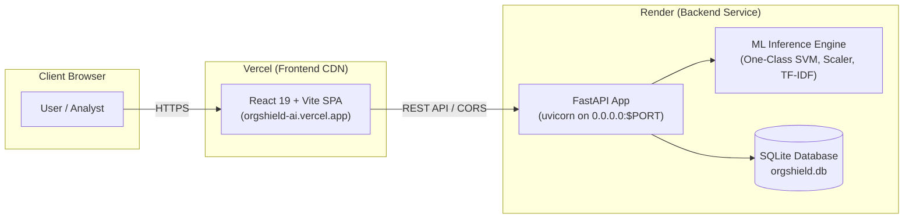

# OrgShield AI — Production Deployment Guide

This document provides complete, step-by-step instructions for deploying **OrgShield AI** to production:
- **Backend API & ML Inference Engine**: Hosted on [Render](https://render.com)
- **Frontend Cybersecurity Dashboard**: Hosted on [Vercel](https://vercel.com)
- **Source Code Repository**: Hosted on [GitHub](https://github.com/bhanuxai/OrgShield_AI)

---

## Table of Contents

1. [Architecture & Deployment Overview](#1-architecture--deployment-overview)
2. [Local Environment Verification](#2-local-environment-verification)
3. [Git Initialization & GitHub Upload](#3-git-initialization--github-upload)
4. [Backend Deployment on Render](#4-backend-deployment-on-render)
5. [Frontend Deployment on Vercel](#5-frontend-deployment-on-vercel)
6. [End-to-End Verification & Smoke Testing](#6-end-to-end-verification--smoke-testing)
7. [Production Troubleshooting Guide](#7-troubleshooting--operational-considerations)

---

## 1. Architecture & Deployment Overview



### Components & Ports
| Component | Service | URL / Host | Default Port |
| :--- | :--- | :--- | :--- |
| **Frontend UI** | Vercel | `https://<your-project>.vercel.app` | 443 (HTTPS) |
| **Backend API** | Render Web Service | `https://<your-service>.onrender.com` | `$PORT` (Render dynamic) |
| **Health Check**| Render Web Service | `https://<your-service>.onrender.com/health` | 200 OK |

---

## 2. Local Environment Verification

Before deploying, verify that both the backend and frontend run and pass tests locally.

### 2.1 Backend Local Startup
```powershell
# Set root PYTHONPATH and run uvicorn
$env:PYTHONPATH="."
.venv\Scripts\python.exe -m uvicorn backend.app.main:app --host 127.0.0.1 --port 8000
```
Verify endpoints in another terminal or browser:
- Health check: `http://127.0.0.1:8000/health` (returns `{"status": "healthy"}`)
- API summary: `http://127.0.0.1:8000/api/dashboard/summary`
- Interactive API Docs: `http://127.0.0.1:8000/docs`

### 2.2 Frontend Local Startup & Production Build
```powershell
cd frontend

# Verify production build succeeds without errors
npm run build

# Start local development server
npm run dev
```
Access the dashboard at `http://localhost:5173`.

### 2.3 Run Automated Tests
```powershell
# Run the 20-test automated verification suite
.venv\Scripts\python.exe -m pytest tests/
```
Ensure all 20 tests pass (`20 passed`).

---

## 3. Git Initialization & GitHub Upload

The repository is configured to exclude large raw email archives (`enron_mail_*`, `*.mbox`, `ml/data/external/`) while strictly tracking the serialized model artifacts (`ml/models_store/` ~5.3 MB), evaluation reports (`reports/`), and configuration templates.

### 3.1 Initialize and Stage Repository
Open PowerShell in the project root:

```powershell
# Navigate to project root
cd "C:\Users\Bhanu\Desktop\Email Threat Discovery Without Labelled Phishing _INT396"

# Initialize Git repository
git init

# Verify .gitignore is active before adding
git status
```

> [!IMPORTANT]
> Verify that `enron_mail_20150507`, `enron_mail_20150507_final`, `.venv`, `node_modules`, and `*.db` do **NOT** appear in the untracked files list. Only source code, configuration templates, `ml/models_store`, and reports should be staged.

### 3.2 Commit and Push to GitHub
```powershell
# Stage all permitted files
git add .

# Verify staged files (ensure total size is clean)
git status

# Create the initial commit
git commit -m "feat: OrgShield AI production release with One-Class SVM and evaluation reports"

# Rename branch to main
git branch -M main

# Link to GitHub repository
git remote add origin https://github.com/bhanuxai/OrgShield_AI.git

# Push to GitHub
git push -u origin main
```

---

## 4. Backend Deployment on Render

### Step-by-Step Render Setup

1. **Sign in to Render**:
   - Go to [dashboard.render.com](https://dashboard.render.com).
2. **Create New Web Service**:
   - Click **New +** -> **Web Service**.
   - Select **Build and deploy from a Git repository**.
   - Connect your GitHub account and select `bhanuxai/OrgShield_AI`.
3. **Configure Service Settings**:
   - **Name**: `orgshield-ai-backend` (or your preferred name)
   - **Region**: Choose the region closest to your users (e.g., *Oregon, USA* or *Frankfurt, EU*)
   - **Branch**: `main`
   - **Root Directory**: Leave blank (uses repository root)
   - **Runtime**: `Python 3`
   - **Build Command**:
     ```bash
     pip install -r requirements.txt
     ```
   - **Start Command**:
     ```bash
     uvicorn backend.app.main:app --host 0.0.0.0 --port $PORT
     ```
   - **Instance Type**: `Free`
4. **Configure Environment Variables**:
   Click **Advanced** -> **Add Environment Variable**:
   | Variable | Recommended Value | Note |
   | :--- | :--- | :--- |
   | `PYTHONPATH` | `.` | Ensures Python finds backend and ml packages |
   | `APP_ENV` | `production` | Enables production error handling |
   | `HOST` | `0.0.0.0` | Listens on all interfaces |
   | `PORT` | `10000` | Render assigns `$PORT` automatically; uvicorn will bind to it |
   | `CORS_ORIGINS` | `*` *(or your Vercel URL)* | e.g. `https://orgshield-ai.vercel.app` |
   | `MODEL_DIR` | `ml/models_store` | Path to trained model artifacts |
   | `DATABASE_PATH` | `backend/app/database/orgshield.db` | Path to SQLite database file |
5. **Set Health Check Path**:
   - In **Advanced Settings**, set **Health Check Path** to `/health`.
6. **Deploy**:
   - Click **Create Web Service**.
   - Wait for the build and deployment log to show:
     ```text
     INFO: Application startup complete.
     INFO: Uvicorn running on http://0.0.0.0:10000
     ```
   - Copy your public service URL: `https://orgshield-ai-backend.onrender.com`.

---

## 5. Frontend Deployment on Vercel

### Step-by-Step Vercel Setup

1. **Sign in to Vercel**:
   - Go to [vercel.com](https://vercel.com) and log in with GitHub.
2. **Import Project**:
   - Click **Add New...** -> **Project**.
   - Select `bhanuxai/OrgShield_AI`.
3. **Configure Build Settings**:
   - **Project Name**: `orgshield-ai`
   - **Framework Preset**: `Vite`
   - **Root Directory**: Click *Edit* and select `frontend` (crucial: Vite lives in `frontend/`)
   - **Build Command**: `npm run build` (detected automatically)
   - **Output Directory**: `dist` (detected automatically)
   - **Install Command**: `npm install` (detected automatically)
4. **Configure Environment Variables**:
   Under **Environment Variables**, add:
   | Variable | Value | Description |
   | :--- | :--- | :--- |
   | `VITE_API_BASE_URL` | `https://orgshield-ai-backend.onrender.com` | Your live Render backend URL (no trailing slash) |
5. **Deploy**:
   - Click **Deploy**.
   - Vercel will install dependencies, run Vite build, and provide a production domain:
     `https://orgshield-ai.vercel.app` (or similar).

---

## 6. End-to-End Verification & Smoke Testing

Once both services are deployed, perform these verification checks:

### 1. Backend Health Check
```bash
curl -i https://orgshield-ai-backend.onrender.com/health
```
**Expected Response**:
```json
HTTP/2 200
{"status":"healthy","timestamp":"...","model_loaded":true}
```

### 2. Dashboard API Overview Check
```bash
curl -i https://orgshield-ai-backend.onrender.com/api/dashboard/summary
```
**Expected Response**:
```json
HTTP/2 200
{"kpis":{"total_emails_scanned":...,"threats_blocked":...},"active_model":"one_class_svm","active_threshold":0.7912}
```

### 3. Real-Time Email Scan Check
```bash
curl -X POST "https://orgshield-ai-backend.onrender.com/api/emails/scan" \
  -H "Content-Type: application/json" \
  -d '{
    "raw_email": "From: security@fake-bank-alert.com\nTo: victim@enron.com\nSubject: URGENT: Verify account\n\nClick here immediately: http://192.168.1.1/login"
  }'
```
**Expected Response**:
```json
HTTP/2 200
{"is_anomaly":true,"anomaly_score":...,"threat_level":"HIGH","recommended_action":"QUARANTINE"}
```

### 4. Frontend UI Verification
Open your Vercel URL in a browser:
- [x] **Overview**: Metric cards load without red connection error banners.
- [x] **Threat Inbox**: Threat records and filter options render properly.
- [x] **Email Investigation**: Paste a sample email and click **Scan Email** — anomaly score, gauge, and explanation breakdown display smoothly.
- [x] **Model Evaluation**: Displays One-Class SVM as the selected best model alongside comparative metrics.
- [x] **Settings**: Displays active model (`One-Class SVM`) and calibrated threshold (`0.7912`).

---

## 7. Troubleshooting & Operational Considerations

### 7.1 Render Free Tier Cold Starts
- **Symptom**: The first visit after 15 minutes of inactivity takes 30–50 seconds to respond.
- **Cause**: Render free web services spin down after inactivity.
- **Handling**: OrgShield AI's frontend includes automatic error catching and a prominent **"Retry Connection"** button on the Overview page so users understand the server is waking up.
- **Resolution**: Upgrade to Render Starter ($7/month) to disable sleep, or use an uptime pinger (e.g., UptimeRobot) targeting `/health` every 10 minutes.

### 7.2 Ephemeral SQLite Database on Render Free Tier
- **Symptom**: Scan history records or customized settings revert after the service restarts.
- **Cause**: Render free tier containers use an ephemeral filesystem. On redeploy or spin-up, a fresh container is instantiated.
- **Handling**: OrgShield AI automatically seeds default configuration and sample records on every startup if the database is missing.
- **Permanent Solution**: Attach a persistent disk on Render (`/var/data`), and set `DATABASE_PATH=/var/data/orgshield.db`.

### 7.3 CORS Origin Mismatch
- **Symptom**: Browser console displays `Access-Control-Allow-Origin` error.
- **Fix**: In the Render dashboard, update `CORS_ORIGINS` to match your Vercel domain:
  ```text
  CORS_ORIGINS=https://orgshield-ai.vercel.app,http://localhost:5173
  ```
  The backend parses comma-separated origins dynamically.

### 7.4 SPA Routing (404 on Page Refresh)
- **Symptom**: Navigating to `/scanner` or `/forensics` works, but refreshing the page produces a 404 error.
- **Fix**: The repository includes `frontend/vercel.json` configured with rewrite rules:
  ```json
  {
    "rewrites": [
      { "source": "/(.*)", "destination": "/index.html" }
    ]
  }
  ```
  This ensures Vercel serves `index.html` for all client routes.

### 7.5 API URL Trailing Slash
- **Note**: Ensure `VITE_API_BASE_URL` does **NOT** include a trailing slash (e.g., `https://example.onrender.com`, not `https://example.onrender.com/`). The frontend API client automatically handles subpath formatting.
