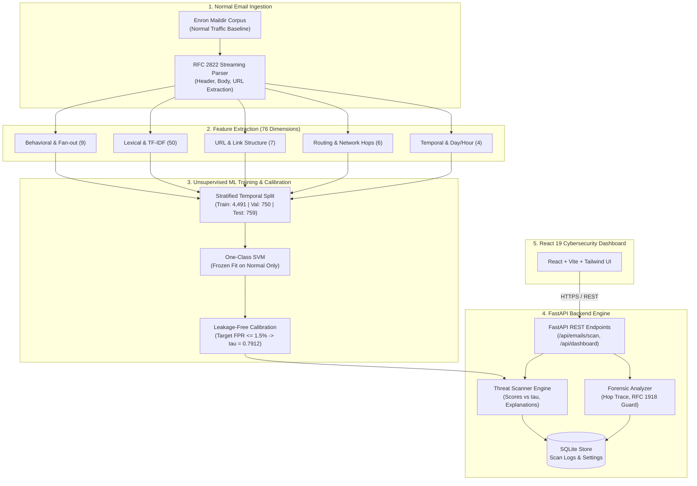

# OrgShield AI
## AI-Powered Email Threat Detection, Geolocation and Forensic Intelligence Platform

[](https://www.python.org/)
[](https://fastapi.tiangolo.com/)
[](https://react.dev/)
[](https://vitejs.dev/)
[](https://tailwindcss.com/)
[]()
[]()

> **Live Deployment Links**:
> - **Frontend Dashboard**: [https://orgshield-ai.vercel.app](https://orgshield-ai.vercel.app) *(Hosted on Vercel)*
> - **Backend REST API**: [https://orgshield-ai-backend.onrender.com](https://orgshield-ai-backend.onrender.com) *(Hosted on Render)*
> - **API Interactive Docs (Swagger)**: [https://orgshield-ai-backend.onrender.com/docs](https://orgshield-ai-backend.onrender.com/docs)
> - **Source Repository**: [https://github.com/bhanuxai/OrgShield_AI](https://github.com/bhanuxai/OrgShield_AI)

---

## 1. Project Overview & Problem Statement

**OrgShield AI** is an organization-aware, unsupervised email threat discovery and cyber forensic platform built to address the **INT396** problem statement:

> **"Email Threat Discovery Without Labelled Phishing Examples"**

### The Core Cybersecurity Problem
Traditional email security appliances rely on signature-based blacklists or supervised classifiers trained on massive archives of historical phishing emails. In real-world enterprise environments, this paradigm fails against:
1. **Zero-Day Phishing & Novel Lures**: Attacks with previously unseen headers, domains, and terminology.
2. **Targeted Spear Phishing & Executive BEC**: Sophisticated impersonations without standard spam keywords.
3. **Label Scarcity**: Most organizations possess vast archives of normal internal email traffic, but very few verified, labeled phishing examples.

### The OrgShield AI Solution
OrgShield AI models the **normal communication baseline** of an enterprise directly from the **Enron Email Dataset** without exposure to phishing labels during training. Incoming emails are evaluated across 76 engineered dimensions spanning behavioral sender familiarity, recipient fan-out, TF-IDF lexical distributions, URL structures, routing hop inconsistencies, and temporal transmission anomalies.

---

## 2. Key Capabilities & System Features

- **Unsupervised Anomaly Discovery**:
  - **One-Class SVM** (Selected Best ML Model, calibrated threshold $\tau = 0.7912$, ROC-AUC 0.9926 on benchmark).
  - **Isolation Forest** (Ensemble tree-based isolation).
  - **Local Outlier Factor** (Novelty density mode).
  - **Rule-Based Baseline** (Deterministic heuristics for side-by-side comparison).
- **Strict Leakage-Free Calibration**:
  - Operating decision thresholds ($\tau$) are calibrated exclusively on normal validation emails under a strict operational constraint of $\text{FPR} \le 1.5\%$ ($\le 15$ false alarms per 1,000 legitimate emails).
- **Forensic & Geolocation Integrity**:
  - Deep inspection of RFC 2822 `Received:` hops, Reply-To mismatches, and URL characteristics.
  - **Zero Invented Geolocation**: Internal RFC 1918 private IPs (`10.x`, `192.168.x`, `172.16-31.x`) and loopback addresses are explicitly labeled *Unavailable*. Only routable public IPs display approximate relay location.
- **Enterprise Cybersecurity SaaS Dashboard**:
  - Built with React 19, Vite, and Tailwind CSS.
  - Modern dark cybersecurity palette (`#070A12`, `#0B0F19`, `#0EA5E9`), responsive data tables, Recharts visualizations, and Lucide icons.
  - Seven dedicated views: Overview, Threat Inbox, Real-Time Email Investigation, Analytics, Forensic Intelligence, Model Evaluation, and Settings.
- **Production-Ready & Dual-Cloud Architected**:
  - Backend deployed on Render with dynamic CORS and health checks.
  - Frontend deployed on Vercel with SPA routing rewrite rules.

---

## 3. Technology Stack

| Layer | Technologies |
| :--- | :--- |
| **Machine Learning** | Python 3.12, Scikit-learn, Pandas, NumPy, Scipy, TF-IDF Vectorizer, Joblib |
| **Anomaly Models** | One-Class SVM (RBF kernel), Isolation Forest, Local Outlier Factor (Novelty) |
| **Backend API** | FastAPI 0.110+, Uvicorn (ASGI), Pydantic v2, Python-Dateutil, Requests |
| **Database** | SQLite (Metadata, audit logs, scan history, system settings) |
| **Frontend UI** | React 19, Vite 6, Tailwind CSS 3.4, Lucide React, Recharts |
| **Testing** | Pytest 8.0+, Httpx (20 passed unit & integration tests) |
| **Deployment** | Render (Backend Web Service), Vercel (Frontend SPA CDN) |

---

## 4. Architecture & Data Flow



---

## 5. API Specification

The FastAPI backend exposes the following RESTful endpoints:

| Endpoint | Method | Description |
| :--- | :---: | :--- |
| `/health` | `GET` | Render service health check probe |
| `/api/health` | `GET` | Application health and model readiness status |
| `/api/dashboard/summary` | `GET` | High-level KPI metrics, detection statistics, and active model |
| `/api/emails/scan` | `POST` | Scan raw RFC 2822 email text, return anomaly score, threat level, and breakdown |
| `/api/emails/alerts` | `GET` | Retrieve historical scan log and quarantined threats |
| `/api/emails/alerts/{id}` | `GET` | Retrieve forensic details for a specific email alert |
| `/api/analytics/breakdown` | `GET` | Risk level distributions, top alert categories, and sender domain frequencies |
| `/api/models/evaluation` | `GET` | Comparative benchmark metrics across all unsupervised models |
| `/api/settings` | `GET` | Current active model, threshold, and operational configuration |
| `/api/settings` | `PUT` | Update active model or anomaly score threshold |

Interactive Swagger documentation is available at `/docs` (e.g. `https://orgshield-ai-backend.onrender.com/docs`).

---

## 6. Scientific Methodology & Evaluation

### 6.1 Unsupervised Training Formulation
- **Training Corpus**: 4,491 normal emails sampled from the Enron corpus.
- **Phishing Exposure**: **Zero**. No phishing or malicious emails were present during feature extraction, TF-IDF vocabulary fitting, or model training.
- **Threshold Calibration**: The threshold ($\tau = 0.7912$) was calibrated exclusively using 750 held-out legitimate validation emails to ensure false positive rate $\text{FPR} \le 1.5\%$. Test labels were never observed during calibration.

### 6.2 Benchmark Results Comparison

To evaluate whether the trained model detects email threats, two separate benchmarks were evaluated:
1. **Synthetic / Curated Phishing Benchmark** (100 attacks across Credential Harvesting, Executive BEC, Malware Delivery, Urgent Financial Lures, Account Suspension).
2. **External Nazario Phishing Benchmark** (414 historical in-the-wild phishing emails from monkey.org/~jose/phishing, 2005–2007).

Both benchmarks are evaluated against the identical held-out legitimate Enron test partition (**759 normal emails**):

| Benchmark Set | Model | Detection Rate | FP / 1,000 Normal | Precision | Recall | F1-Score | PR-AUC | ROC-AUC |
| :--- | :--- | :---: | :---: | :---: | :---: | :---: | :---: | :---: |
| **Synthetic Benchmark** *(100 attacks)* | **One-Class SVM** | **97.00%** | **10.54** | **0.9238** | **0.9700** | **0.9463** | **0.9685** | **0.9926** |
| Synthetic Benchmark *(100 attacks)* | Isolation Forest | 83.00% | 25.03 | 0.8137 | 0.8300 | 0.8218 | 0.8944 | 0.9572 |
| Synthetic Benchmark *(100 attacks)* | Local Outlier Factor | 10.00% | 5.27 | 0.7143 | 0.1000 | 0.1754 | 0.1492 | 0.6874 |
| Synthetic Benchmark *(100 attacks)* | Rule-Based Baseline | 100.00% | 3.95 | 0.9709 | 1.0000 | 0.9852 | 0.9914 | 0.9980 |
| **External Nazario** *(414 attacks)* | **One-Class SVM** | **60.14%** | **10.54** | **0.7569** | **0.6014** | **0.6703** | **0.6277** | **0.9298** |

### 6.3 Scientific Transparency: Why the 97% Result Does NOT Generalise Directly

> [!WARNING]
> **Independent Audit Finding**: The 97.00% detection rate observed on the synthetic benchmark represents performance on structured, prototypical attack lures. It does **not** indicate a 97% real-world detection rate against arbitrary external or modern phishing attacks.

When evaluated against the independently sourced Nazario dataset without retraining or threshold adjustment, the One-Class SVM achieved a **60.14% detection rate** (ROC-AUC 0.9298, Precision 0.7569). A rigorous domain-shift audit revealed several technical drivers of this variance:

1. **Vocabulary Out-of-Vocabulary (OOV) Rate**:
   - **46.80%** of unique tokens in the Nazario dataset were completely absent from the Enron training vocabulary ($V_{\text{train}} = 50$).
   - The average number of non-zero TF-IDF features per email dropped from **17.58** (Enron test) to **8.16** (Nazario), reducing lexical signal.
2. **Sender Domain Shift**:
   - **96.86%** of Nazario emails originated from previously unseen sender domains.
3. **Missing Header Distribution**:
   - 28.5% of Nazario emails lacked standard `Message-ID` headers, and 12.6% had malformed or missing `Date` headers due to legacy forwarding and capture methods.
4. **Temporal Gap**:
   - The Enron baseline reflects corporate internal traffic from 1998–2002, whereas Nazario reflects public webmail attacks from 2005–2007.

The model remains robust ($ROC\text{-}AUC = 0.9298$ on external data) while maintaining an exceptionally low false positive rate (**10.54 false alarms per 1,000 normal emails**), satisfying the INT396 requirement for label-free discovery.

Full audit reports and reproducibility scripts:
- [reports/evaluation/independent_audit.md](file:///c:/Users/Bhanu/Desktop/Email%20Threat%20Discovery%20Without%20Labelled%20Phishing%20_INT396/reports/evaluation/independent_audit.md)
- [reports/evaluation/external_generalisation_evaluation.md](file:///c:/Users/Bhanu/Desktop/Email%20Threat%20Discovery%20Without%20Labelled%20Phishing%20_INT396/reports/evaluation/external_generalisation_evaluation.md)
- [reports/evaluation/final_integrity_and_domain_shift_audit.md](file:///c:/Users/Bhanu/Desktop/Email%20Threat%20Discovery%20Without%20Labelled%20Phishing%20_INT396/reports/evaluation/final_integrity_and_domain_shift_audit.md)

---

## 7. Directory Structure

```text
.
├── backend/
│   ├── app/
│   │   ├── api/             # REST endpoints (health, scan, alerts, analytics, settings)
│   │   ├── core/            # Configuration and security settings
│   │   ├── database/        # SQLite connection, schema, and initial seeder
│   │   ├── models/          # Pydantic request/response schemas
│   │   ├── services/        # Analytics and aggregation business logic
│   │   └── main.py          # FastAPI application entry point with CORS & health checks
│   └── requirements.txt     # Backend Python dependencies
├── frontend/
│   ├── src/
│   │   ├── components/      # UI widgets, metric cards, and charts
│   │   ├── hooks/           # Telemetry and state hooks
│   │   ├── layouts/         # Dashboard layout and navigation sidebar
│   │   ├── pages/           # 7 views (Overview, Inbox, Scanner, Analytics, Forensics, Evaluation, Settings)
│   │   ├── services/        # API communication client with dynamic baseURL
│   │   ├── App.jsx          # Root view controller
│   │   └── main.jsx         # React DOM bootstrap
│   ├── .env.example         # Frontend environment template
│   ├── package.json
│   ├── tailwind.config.js
│   ├── vercel.json          # SPA rewrite rules for Vercel
│   └── vite.config.js
├── ml/
│   ├── data/                # Phishing benchmark dataset (100 curated attacks)
│   ├── preprocessing/       # Robust RFC 2822 streaming parser and dataset explorer
│   ├── features/            # 76-dimensional feature extraction engine
│   ├── training/            # Unsupervised training, threshold calibration, and evaluation
│   ├── inference/           # Real-time email threat scanner and forensic engine
│   ├── evaluation/          # Deterministic rule-based baseline detector
│   └── models_store/        # Serialized models (.joblib, 5.3 MB total) and metadata
├── reports/
│   ├── dataset/             # dataset_inventory.json and dataset_statistics.json
│   └── evaluation/          # Independent audit, external evaluation, and domain shift reports
├── scripts/
│   ├── run_dataset_exploration.py       # Standalone dataset inventory generator
│   ├── train_models.py                  # Model training runner
│   ├── seed_database.py                 # SQLite test seeder
│   ├── start_backend.py                 # FastAPI uvicorn server launcher
│   ├── build_phishing_benchmark.py      # Phishing benchmark generator
│   ├── evaluate_external_benchmark.py   # External Nazario evaluation runner
│   └── run_final_integrity_audit.py     # Final scientific integrity verification
├── tests/
│   ├── test_backend_api.py              # 10 integration tests for FastAPI
│   ├── test_email_parser.py             # Parser and IP classification unit tests
│   ├── test_external_evaluation.py      # External benchmark verification tests
│   ├── test_feature_extractor_quick.py  # Feature extraction tests
│   └── test_unsupervised_models.py      # Model score and calibration unit tests
├── .env.example             # Backend environment template
├── .gitignore               # Strict exclusion of raw datasets, caches, and node_modules
├── DEPLOYMENT.md            # Complete step-by-step Render & Vercel deployment guide
├── render.yaml              # Render blueprint specification
├── requirements.txt         # Root Python requirements
└── README.md
```

---

## 8. Installation & Quickstart

### Prerequisites
- Python 3.12+
- Node.js 18+ and npm

### Step 1: Clone and Configure Environment
```bash
git clone https://github.com/bhanuxai/OrgShield_AI.git
cd OrgShield_AI

# Setup Python virtual environment
python -m venv .venv

# Activate environment (Windows PowerShell)
.venv\Scripts\activate
# Activate environment (Linux / macOS)
# source .venv/bin/activate

# Install dependencies
pip install -r requirements.txt
```

### Step 2: Install Frontend Dependencies
```bash
cd frontend
npm install
cd ..
```

### Step 3: Start Local Backend Server
```powershell
$env:PYTHONPATH="."
.venv\Scripts\python.exe -m uvicorn backend.app.main:app --host 127.0.0.1 --port 8000
```
- API Docs: `http://127.0.0.1:8000/docs`
- Health: `http://127.0.0.1:8000/health`

### Step 4: Start Frontend Dashboard
In a separate terminal:
```bash
cd frontend
npm run dev
```
- Access Dashboard: `http://localhost:5173`

---

## 9. Production Deployment

For complete, detailed instructions on deploying the backend to **Render** and the frontend to **Vercel**, refer to:

👉 **[DEPLOYMENT.md](file:///c:/Users/Bhanu/Desktop/Email%20Threat%20Discovery%20Without%20Labelled%20Phishing%20_INT396/DEPLOYMENT.md)**

### Brief Deployment Summary:
1. **GitHub**: Push the code to `https://github.com/bhanuxai/OrgShield_AI`. Raw datasets and local databases are automatically excluded by `.gitignore`. Serialized model artifacts (5.3 MB total) are tracked directly.
2. **Render Backend**:
   - Create a Web Service connected to GitHub.
   - Build Command: `pip install -r requirements.txt`
   - Start Command: `uvicorn backend.app.main:app --host 0.0.0.0 --port $PORT`
   - Set `PYTHONPATH=.`, `APP_ENV=production`, `CORS_ORIGINS=*`.
   - Health check path: `/health`.
3. **Vercel Frontend**:
   - Import the repository and select `frontend` as Root Directory.
   - Framework preset: `Vite`.
   - Set Environment Variable: `VITE_API_BASE_URL=https://your-render-service.onrender.com`.

---

## 10. Automated Testing

OrgShield AI includes an automated test suite covering RFC 2822 email parsing, IP classification, feature engineering, unsupervised anomaly detection, and FastAPI REST endpoints.

Run the test suite:
```powershell
.venv\Scripts\python.exe -m pytest tests/
```

Test Results:
```text
============================= test session starts =============================
platform win32 -- Python 3.12.16, pytest-9.2.0, pluggy-1.7.0
rootdir: C:\Users\Bhanu\Desktop\Email Threat Discovery Without Labelled Phishing _INT396
collected 20 items

tests\test_backend_api.py ..........                                     [ 50%]
tests\test_email_parser.py ....                                          [ 70%]
tests\test_external_evaluation.py ..                                     [ 80%]
tests\test_feature_extractor_quick.py .                                  [ 85%]
tests\test_unsupervised_models.py ...                                    [100%]

======================== 20 passed, 1 warning in 9.62s ========================
```

---

## 11. Academic Limitations & Future Work

### Limitations
1. **Historical Domain Divergence**: The Enron corpus reflects corporate norms from 1998–2002. Modern enterprise communication patterns (cloud links, Google Docs, Slack notifications) require updated domain whitelists.
2. **Intermediate Mail Relay Uncertainty**: Received headers reflect intermediate SMTP relays. While IP geolocation can be inferred for public transit nodes, physical sender locations cannot be definitively proven from headers alone.
3. **High-Dimensional Distance Concentration**: Density-based estimators like Local Outlier Factor experience reduced discrimination in high-dimensional feature spaces (> 50 dimensions).

### Future Enhancements
1. **Continual Online Learning**: Incremental model updates adapting to shifting employee communication clusters over time.
2. **Transformer Embeddings**: Incorporating fine-tuned open-source small language models (e.g., DeBERTa-v3) for contextual semantic anomaly scoring alongside behavioral tabular features.
3. **Graph Neural Networks (GNNs)**: Modeling organizational communication graphs to detect subtle account compromise and lateral movement.
