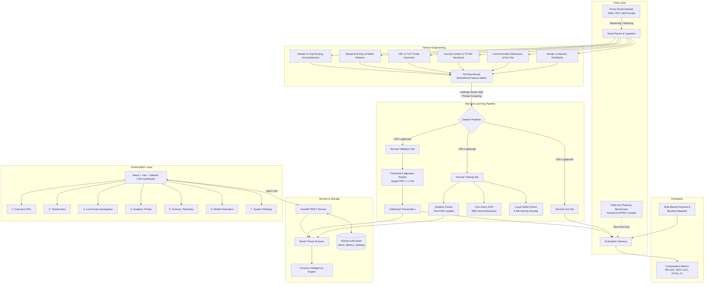

# OrgShield AI - System Architecture

## 1. Executive Architecture Summary

**OrgShield AI** is an organization-aware, unsupervised email threat discovery and cyber forensic platform built to address the **INT396** problem statement:
> *"Email Threat Discovery Without Labelled Phishing Examples"*

Unlike traditional supervised spam/phishing classifiers that rely on historical attack signatures, OrgShield AI models normal organizational communications from the **Enron Email Dataset** without exposure to phishing labels during training. The system flags suspicious incoming communications by measuring multi-dimensional behavioral, structural, lexical, routing, and temporal deviations against the organization's normal operating baseline.

---

## 2. Component Architecture Diagram

---

## 3. Core Architectural Modules

### 3.1 Data Ingestion (`ml/preprocessing/email_parser.py`)
- Reads raw RFC 2822 / 822 email payloads in binary and text streams.
- Robustly handles malformed messages, missing headers, and multi-part encodings (`utf-8`, `latin-1`, `cp1252`).
- Extracts routing hops from `Received:` headers and normalizes subjects for thread tracking.
- Performs URL extraction, detecting IP-based hosts, suspicious TLDs, and URL shorteners.

### 3.2 Feature Engineering (`ml/features/feature_extractor.py`)
- Learns baseline frequency distributions for senders, domains, and sender-recipient interaction pairs strictly from training data.
- Fits a 40-feature TF-IDF vectorizer over email subjects and bodies.
- Concatenates 36 domain-specific tabular features with 40 TF-IDF features into a 76-dimensional vector.

### 3.3 Unsupervised Anomaly Modeling (`ml/training/train_and_evaluate.py`)
- **Isolation Forest**: Primary unsupervised ensemble model isolating anomalies via random partitioning.
- **One-Class SVM**: RBF kernel estimator learning the support boundary of normal communication vectors.
- **Local Outlier Factor**: Density-based estimator evaluating local reachability relative to k-nearest neighbors.
- **Rule-Based Baseline**: Deterministic heuristic benchmark checking keywords, IP URLs, and reply-to mismatches.

### 3.4 Operational Calibration Engine
- Calibrates the anomaly decision threshold $\tau$ strictly on **legitimate validation data**.
- Sets $\tau$ such that the allowable False Positive Rate ($FPR_{target}$) $\le 1.5\%$ (15 false alarms per 1,000 legitimate emails).
- Prevents data leakage: zero phishing samples are exposed to the models during feature extraction, training, or threshold calibration.

### 3.5 Forensic Intelligence Engine (`ml/inference/forensic_engine.py`)
- Inspects every email for Reply-To mismatches, missing message headers, and URL risks.
- IP Telemetry: Evaluates all origin IPs in `Received` headers.
- **Strict Geolocation Integrity**: Explicitly reports private RFC 1918 addresses (`10.x`, `192.168.x`, `172.16-31.x`) and loopback addresses as *Unavailable*. Only routable public IPs display approximate geolocation, accompanied by relay hop disclaimers.

### 3.6 REST API Backend (`backend/app/main.py`)
- FastAPI service with Pydantic validation, CORS middleware, and SQLite persistence.
- Provides endpoints for real-time single and bulk email scanning, alert audit management, dataset exploration telemetry, and model configuration.

### 3.7 Cybersecurity SaaS Frontend (`frontend/`)
- Built with React 19, Vite, Tailwind CSS, Lucide icons, and Recharts.
- Enterprise dark palette (`#070A12`, `#0B0F19`, `#0EA5E9`) with zero emojis and responsive layouts.
